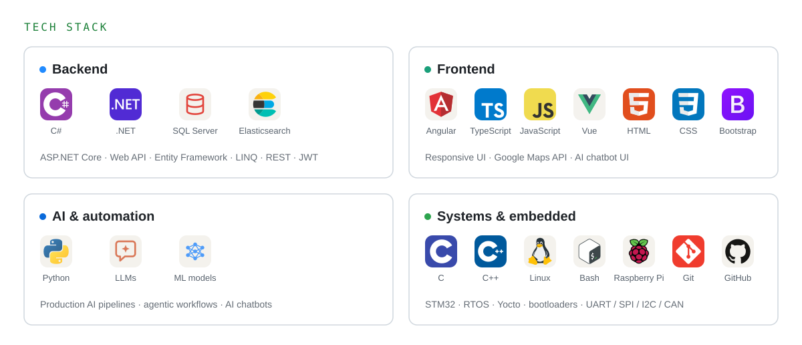
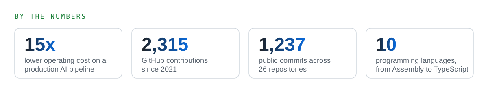

  <picture></picture>

  <picture></picture>

  <a href="https://www.linkedin.com/in/hosamayoub"><picture><source media="(prefers-color-scheme: dark)" srcset="./assets/contact-linkedin-dark.svg"></picture></a>
  <a href="mailto:hosamayoub50@gmail.com"><picture><source media="(prefers-color-scheme: dark)" srcset="./assets/contact-email-dark.svg"></picture></a>
  <picture><source media="(prefers-color-scheme: dark)" srcset="./assets/contact-location-dark.svg"></picture>

---

## About me

I love building solutions, and I started at the metal: as an Electronics & Communications Engineering student I built an 8-bit single-cycle **MIPS processor**, wrote **ATmega32 / STM32 drivers**, and developed an **STM32 dual-bank bootloader with rollback** for over-the-air firmware updates.

Then I moved deliberately up the stack. After ITI's Full-Stack .NET program I build web systems in **C# / .NET, SQL Server and Angular**. Today I'm a **Software Engineer at Z2Data**, where I develop the core .NET / Angular product and co-built a **production AI pipeline** (LLM + ML models on .NET) that multiplied daily event intake, filters and prioritizes events automatically, and cut operating costs by **15x**.

The hardware years still shape how I work: I debug across every layer, from device constraints up to business logic, and I care about performance and cost.

  <picture>
    <source media="(prefers-color-scheme: dark)" srcset="./assets/tech-stack-dark.svg">
    
  </picture>

  <picture>
    <source media="(prefers-color-scheme: dark)" srcset="./profile/stats-dark.svg">
    
  </picture>

---

  Interested in backend, full-stack or AI automation work? Let's talk on
  <a href="https://www.linkedin.com/in/hosamayoub">LinkedIn</a> or by <a href="mailto:hosamayoub50@gmail.com">email</a>.

