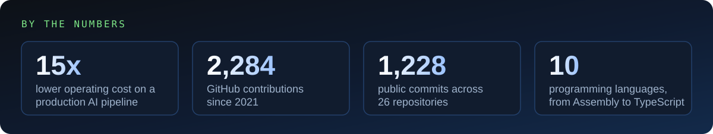

  

  

  
  
  

---

## About me

I love building solutions, and I started at the metal: as an Electronics & Communications Engineering student I built an 8-bit single-cycle **MIPS processor**, wrote **ATmega32 / STM32 drivers**, and developed an **STM32 dual-bank bootloader with rollback** for over-the-air firmware updates.

Then I moved deliberately up the stack. After ITI's Full-Stack .NET program I build web systems in **C# / .NET, SQL Server and Angular**. Today I'm a **Software Engineer at Z2Data**: I spent my first months maintaining and extending their product (.NET, SQL Server, Angular, Elasticsearch), then co-built, with the technical head, an **AI pipeline** that uses an LLM and ML models on C# / .NET and SQL to catch supply-chain events and news. It multiplied daily event intake, filters out most of the noise and ranks what's left, so the data team reviews only what matters. Through optimization we cut its operating cost by **15x**, and I solved a performance bottleneck in one of its ML models.

The hardware years still shape how I work: I debug across every layer, from device constraints up to business logic, and I care about performance and cost.

- **Now:** Software Engineer @ Z2Data (Dec 2025 - present) · before that, INFOSAS (multi-tenant legacy ERP)
- **Education:** B.Sc. Electronics & Electrical Communications Engineering, Fayoum University, Very Good with Honors
- **Graduation project:** SOVA smart glasses, graded Excellent and ranked 1st in the department
- **Workflow:** agent-first development, with Claude Code as my daily driver
- **Languages:** Arabic (native) · English (professional)

## Tech stack

<table>
  <tr>
    <td><b>Backend</b></td>
    <td>
      
      
       ASP.NET Core · Web API · Entity Framework · LINQ · ADO.NET · MVC · JWT auth · REST API design
    </td>
  </tr>
  <tr>
    <td><b>Frontend</b></td>
    <td>
      
    </td>
  </tr>
  <tr>
    <td><b>AI & automation</b></td>
    <td>
      
      
       LLM automation pipelines · agentic workflows · AI chatbot integration
    </td>
  </tr>
  <tr>
    <td><b>Systems & tools</b></td>
    <td>
      
       STM32 · ATmega32 · RTOS · Yocto · bootloaders · UART / SPI / I2C / CAN
    </td>
  </tr>
</table>

## Featured projects

<table>
  <tr>
    <td width="50%" valign="top">
      <h3><a href="https://github.com/HosamAyoub/PharmaLink">💊 PharmaLink</a></h3>
      A web platform that brings pharmacies into one place: find medicines, check availability, and get AI-suggested alternatives.
      I led it end to end, from architecture and team management to deployment, and built the <b>JWT-authenticated .NET Core APIs</b>.
        
      <code>.NET Core</code> <code>Angular</code> <code>JWT</code> <code>Google Maps API</code> <code>AI chatbot</code>
       <a href="https://github.com/HosamAyoub/PharmaLink">API</a> · <a href="https://github.com/HosamAyoub/PharmaLink-Angular">Angular front end</a>
    </td>
    <td width="50%" valign="top">
      <h3><a href="https://github.com/HosamAyoub/SOVA">🕶️ SOVA</a></h3>
      Offline smart glasses for the visually impaired: real-time, voice-activated OCR and face, object and color detection
      on a <b>Yocto-customized Raspberry Pi</b> Linux image. <b>Ranked 1st in the department.</b>
        
      <code>Python</code> <code>ML / DL</code> <code>OCR</code> <code>Yocto</code> <code>Raspberry Pi</code>
    </td>
  </tr>
  <tr>
    <td width="50%" valign="top">
      <h3><a href="https://github.com/HosamAyoub/AutoNXT">🚗 AutoNXT</a></h3>
      Automotive platform with secure Firmware Over-The-Air updates: an <b>STM32 dual-bank bootloader with rollback</b> and a
      Python update manager on a Raspberry Pi that validates and sends encrypted updates over USART.
        
      <code>STM32</code> <code>C</code> <code>FreeRTOS</code> <code>Python</code> <code>Bootloader</code>
    </td>
    <td width="50%" valign="top">
      <h3>More from the lab</h3>
      <a href="https://github.com/HosamAyoub/MIPS-Processor">MIPS Processor</a> - 8-bit single-cycle CPU running R, I and J-type instructions 
      <a href="https://github.com/HosamAyoub/POV-display">POV Display</a> - persistence-of-vision analog clock on ATmega32 
      <a href="https://github.com/HosamAyoub/Nojoom-FM">Nojoom FM</a> - STM32 radio emulator: TFT, LED matrix and DAC audio at once 
      <a href="https://github.com/HosamAyoub/Smart-Home">Smart Home</a> - two ATmega32s over USART, SPI and I2C, controlled by Bluetooth 
      <a href="https://github.com/HosamAyoub/E-Commerce">E-Commerce</a> - responsive storefront with cart, search and filters
    </td>
  </tr>
</table>

  

---

  Interested in backend, full-stack or AI automation work? Let's talk on
  <a href="https://www.linkedin.com/in/hosamayoub">LinkedIn</a> or by <a href="mailto:hosamayoub50@gmail.com">email</a>.

